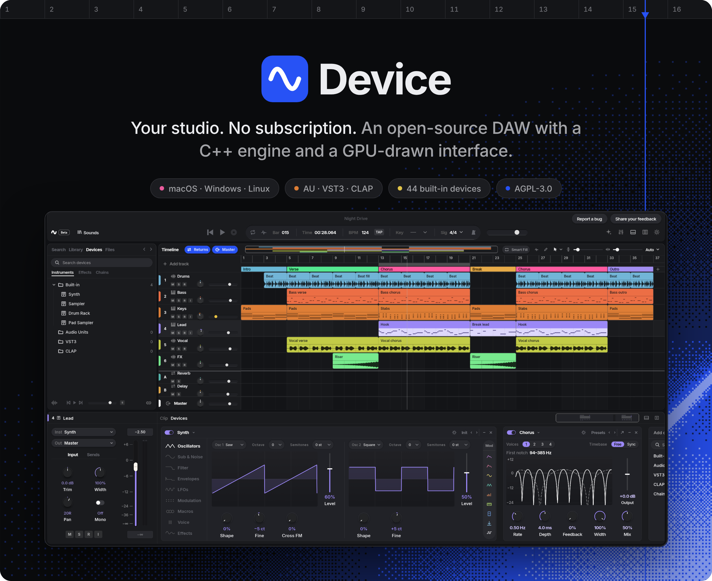
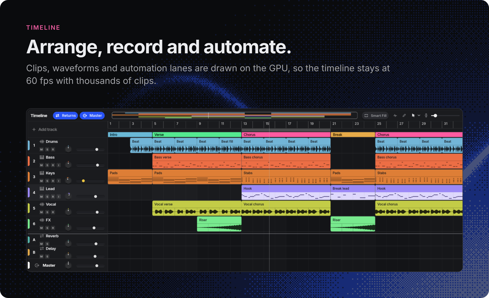
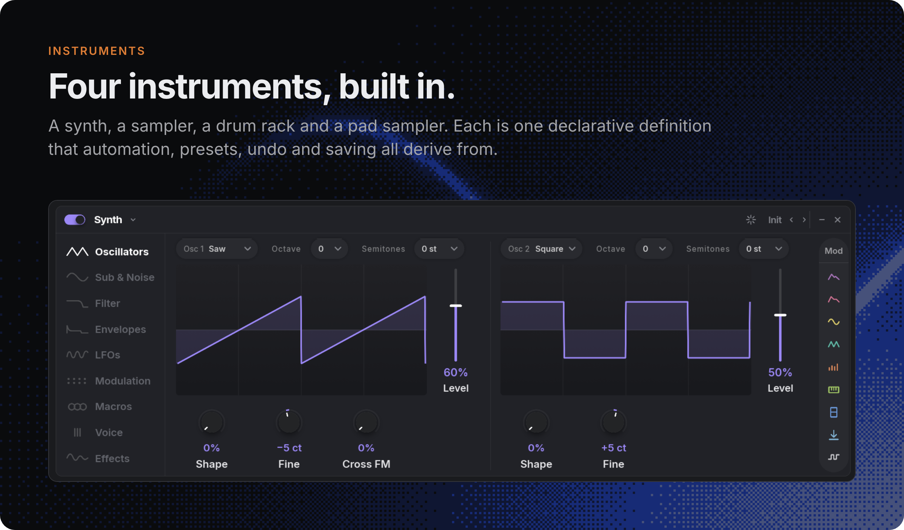
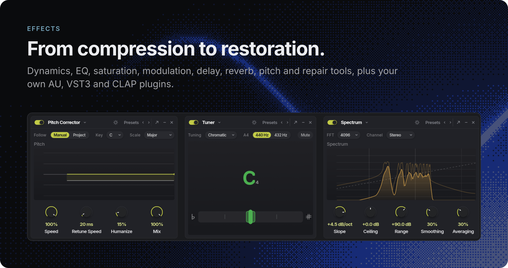
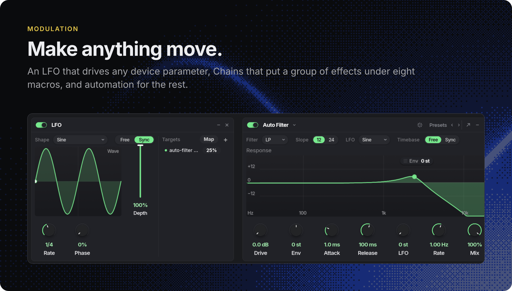
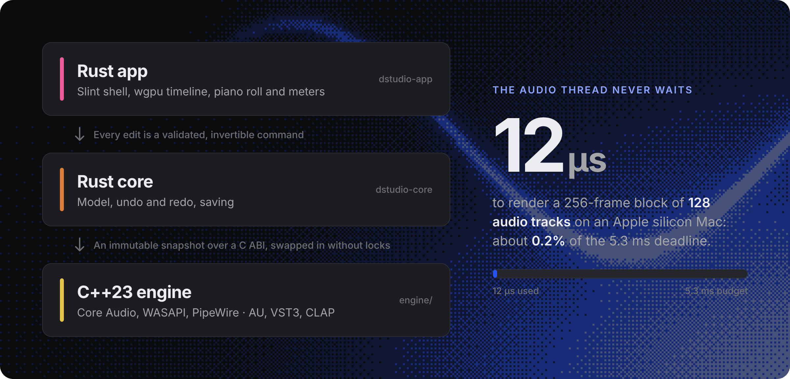

<!-- Keep this README current: see "Keeping this README up to date" under Development. -->

<div align="center">

<h1></h1>

<p>
  <a href="https://github.com/devicedaw/device/actions/workflows/ci.yml"></a>
  <a href="https://github.com/devicedaw/device/actions/workflows/perf.yml"></a>
  
  
  
  
  <a href="LICENSE"></a>
</p>

<p>
  <a href="https://devicedaw.github.io/"><b>Website</b></a> ·
  <a href="#build-from-source"><b>Build</b></a> ·
  <a href="docs/architecture.md"><b>Architecture</b></a> ·
  <a href="docs/devices.md"><b>Devices</b></a> ·
  <a href="PROGRESS.md"><b>Progress</b></a>
</p>

</div>

---

## What is Device?

Device is a linear, track-based music production program. You record or import audio, write parts in the piano
roll, shape sounds with the built-in instruments and effects or your own AU, VST3 and CLAP plugins, automate anything,
and mix in the mixer. The audio engine is written in C++23 and never allocates or locks on the audio thread; the
interface is written in Rust with Slint, and the timeline, waveforms, piano roll and meters are drawn on the GPU with
wgpu.

> [!WARNING]
> **Device is pre-alpha.** The latest release, [0.2.0](https://github.com/devicedaw/device/releases/latest), is out to try, but features are missing and the project format may still
> change. macOS is the platform it's developed and tested on every day. Windows audio has been checked on one PC's
> built-in sound card; Linux audio has never run on a physical sound card (it runs real PipeWire and ALSA streams in CI). Keep copies of anything you care about.

## Features

- **Timeline.** Double-click an empty spot on an instrument track to make a MIDI clip there (or right-click it, or
  use Create › MIDI Clip), import audio, move and trim clips, loop a range, and play against a metronome.
  With Smart Fill on, drag over a gap on a track to fill it with a part from the pattern library (or describe one
  for the assistant to write), or to record straight into it.
  Right-click a track header to rename, recolour, delete, group, bounce in place or duplicate the track (with or without
  its clips), show its automation, or add an audio, instrument, Sampler, Drum or return track right below it; the same
  rows end the menu of an empty lane, which starts with Open <instrument> and Insert empty MIDI clip. Drag headers up
  and down to reorder the tracks. Shift-click clips, or drag a box over empty lane space, to select
  several and move, duplicate, copy, paste, disable or delete them together. Drag the square handles at an audio
  clip's top corners to fade it in and out. Set the tempo in the
  transport bar by dragging, typing or tapping it, and pick the time signature and the project's key there too.
  For a song that changes tempo, pick Song › Tempo on the master row's lane: click the line to add a tempo change,
  drag it, and right-click a point to ramp smoothly to the next one. The ruler marks every change, and the transport
  bar shows and edits the tempo at the playhead. Exports, MIDI files and Live sets carry the tempo changes.
  A new key for a project with MIDI clips offers to transpose them with it.
  Markers label the parts of a song on the ruler; right-click one to cut, copy, paste, colour or rename it, or to insert
  a marker before or after it. Turn on Settings › General › Sections move clips and moving, resizing, copying or
  deleting a marker takes its clips and automation with it.
  Press W to fit the song (or the selected clips) to the width of the timeline, and H to fit every track into its height;
  the two zoom sliders in the timeline header set the zoom and the track height directly (double-click resets them).
  The tool button in the timeline header picks the Selector, the Marquee tool (drag a stretch of time across tracks,
  then delete, cut, copy, paste, duplicate, split or loop it with the usual keys) or Scissors (T toggles them; click a
  clip to cut it at the pointer).
  Waveforms, clips and the playhead are drawn on the GPU, so the timeline stays at 60 fps with thousands of clips.
  Shortcuts cover the common moves: ⇧⌘T adds an instrument track, ⌘R reverses the selected clip, ⌘L loops the selected
  clip or marker, ⌘D duplicates the selected clip or marker. Click an effect's header to select it (⇧ or ⌘ for more);
  ⌘D duplicates the selected effects, ⌘G puts them in a new chain and ⌘⇧G unpacks a selected chain. Settings › Shortcuts lists them all by section; click
  one's keys to record new ones, search by name or key, and reset to the defaults at any time. Its Preset menu swaps in
  the keys of Ableton Live, Logic Pro, GarageBand, FL Studio, Fender Studio Pro, Bitwig, Pro Tools or BandLab. ↑/↓ select the track above
  or below, ⇧↑/⇧↓ (⌘⇧ for an octave) transpose the selected MIDI clips, U folds a group, A shows automation, I
  monitors the selected track's input and ⌘⌥M shows the mixer. In the piano roll, ⌘↑/⌘↓ (⌥ for 10) change the
  selected notes' velocity and ←/→ (⇧ for a bar) move them. 0 or M mutes the selected clips (or the track), ←/→ step
  through the mixer's strips, ⇧Tab switches between the clip editor and the devices, and ⌘=/⌘-/⌘0 zoom the interface.
  Moving clips to the track above or below and gluing notes have no key until you record one.
  The mouse works with modifiers too: ⌥-drag copies clips, ⇧-drag on a clip's right edge time-stretches it, the
  top-right corner loops it, ⌥ + scroll sizes the track rows, a double-click deletes a note, and on knobs ⇧-drag
  fine-tunes and ⌥-click resets. Settings › Shortcuts lists them under Mouse & modifiers. Search settings, at the
  top of the Settings sidebar, finds any setting by name or by what it's for (⌘F), and hovering the (i) after a
  setting's name says in one sentence what it does. Settings › Downloads will list optional content such as sound
  libraries; there is none yet.
- **Piano roll.** Draw, move and resize notes, then quantize, transpose or humanize them. Clicking, drawing or dragging a
  note, or clicking a key, plays it through the track's instrument for its length (up to a second). A velocity lane under the
  notes lets you drag one note's velocity, or sweep across several to paint them.
- **Printing clips.** Consolidate joins clips into one, Bounce to new track (⌘B, or Resample in the clip menu and the
  audio clip editor) renders a clip through its track's devices onto a new track, Bounce track in place prints a whole
  track to one audio clip and turns it into an audio track (its devices kept, switched off), and Export audio saves one clip as a
  WAV. Renders run in the background while you keep working, and each is one undo step. Export MIDI saves a MIDI clip as
  a standard MIDI file, and Send to Sampler puts an audio clip on a new track, played by a Sampler.
- **Recording.** Arm tracks, pick inputs, monitor, and record takes that land where you played them: latency
  compensation is measured with an acoustic loopback test, not guessed, and an interface that reports its latency
  wrongly gets a recording offset of its own in Settings › Audio. Right-click the record button for a one- or
  two-bar count-in: the click plays from that far back and the take starts where you pressed record. Record with the
  loop on and every pass becomes a take of one clip: pick one from the clip menu's Takes, or split the clip and pick
  a take for each part to comp.
- **MIDI input.** Plug in a MIDI keyboard, arm (R) or monitor (I) instrument tracks to play them, and record
  what you play into MIDI clips, looped passes included. Core MIDI, Windows MIDI and the ALSA sequencer.
- **Mixer.** Faders, pan, mute, solo, stereo meters with peak hold, and a master strip with its own mute. Each
  track's channel strip adds a trim (±24 dB), a stereo width knob (0 to 200 %) and a mono switch. Return
  tracks share one effect between many tracks: every track has a send knob for each return, pre- or post-fader, and
  delay compensation keeps the direct and the returned signal aligned. Group tracks (⌘G, or Add track › Group
  track) play their tracks through one set of effects and one fader, and fold away to a single row that
  sums up their clips. Their tracks sit indented under the group, and the mixer marks them with the group's colour.
  A group sends into return tracks like any other track, and a return sends into the returns after it, so a delay
  can echo into a reverb.
- **Instruments.** A subtractive/FM synth, a sampler, a drum rack and a pad sampler, all built in.
  Settings › MIDI › Default instrument picks what a new instrument track (⇧⌘T) plays: any of them, or an
  instrument plugin.
- **Effects.** 20 built-in effects, from compression and saturation to modulation and audio restoration.
- **Device chain.** A level meter after every device shows what it puts out, and the + between two devices
  inserts another one right there, from your recent effects or any category.
- **Modulation and chains.** An LFO that moves any device parameter, and Chains that group effects under eight
  macros. Save a chain to reuse it in any project, or start from one of 27 ready-made chains for vocals, drums, bass,
  guitar, keys, pads, FX and mix bus.
- **Plugins.** Hosts AU (macOS), VST3 and CLAP plugins. Plugins are scanned in a separate process, so a crashing plugin
  is blocklisted instead of taking the app down, and their editors open in their own windows. Besides the standard
  plugin folders, Settings › Plugins scans any folders you add.
- **Delay compensation.** Plugin latency is compensated across every track, the metronome, recording and export, and
  can be switched off.
- **Automation.** Right-click any device control, the channel's volume, pan, mute, trim, width or mono, or a device's
  power switch and choose Automate. Draw lanes with points, curves or freehand, or record your moves with
  touch-write. Lanes read in the parameter's own units (Hz, dB, ms, choice names, On/Off), and mute, mono and device
  on/off lanes switch exactly on their points. Expand a track to show more lanes under it: + adds one for the next
  parameter, × closes one (its automation stays), and right-clicking a lane deletes its automation.
- **Export.** Mix down the arrangement, or export each track as its own stem, as 16- or 24-bit WAV or 192 or 320 kbps
  MP3 at 44.1 or 48 kHz (converted from the engine's rate), over the whole project or just the loop region (an exact-length file that loops
  seamlessly), or export the project as an Ableton Live set that keeps its return tracks and sends. With Effects set to Convert to Live
  devices, a track's Compressor, Utility and Channel EQ become Live devices with the same settings.
- **Undo for everything.** Every edit is a validated, invertible command, so undo and redo cover the whole project.
- **Assistant.** An optional side panel that can explain the app (Teach) or make edits for you (Assist), each turn as
  one undo step. It knows each track's devices, sends and lanes, and can add built-in effects and instruments, set their
  parameters, load samples into the Sampler and Drum Rack, and place audio clips. Ask in a clip's menu (or ⌘K with a
  clip selected) opens it about that clip, and its header button stretches it to the full window height, beside a
  narrower bottom panel. It uses your own Anthropic API key, pasted into the panel once and kept in the system keychain.
- **Use your own AI app.** Turn on Settings › General › Let AI apps control Device and press Copy setup, and an AI app
  that supports MCP on this computer (Claude Desktop, Claude Code, Cursor and others) can read the open project and edit
  it: tracks, MIDI clips and notes, built-in effects and instruments and their settings, tempo, undo and play. Device
  asks once before each app may make changes, and each request is one undo step (AI App Edit). No API key is needed.

### A closer look

<p align="center"></p>

<p align="center"></p>

<p align="center"></p>

<p align="center"></p>

<sub>The app's views are rendered by the app itself (<code>device-studio --screenshot</code>) on Linux with a software GPU, then
framed by <code>tools/art/render.mjs</code>.</sub>

### Built-in devices

Device comes with 44 devices of its own. Each one is a single declarative definition (parameters, panel layout and
factory presets) that the model, undo, saving, automation, engine and panel all derive from, with a C++ DSP kernel
behind it. Auto Filter, Channel EQ and Character EQ also open an expanded window with a large display and live analyser,
In and Out meters and every control laid out in rows, and so do Tremolo, Auto-Panner, Chorus, Flanger, Phaser,
Ring Mod and Character Mod, whose window plots their motion or response with a time or frequency axis and a legend, and
Compressor, Limiter, Gate, Glue Compressor, Character Compressor and Mastering Limiter, whose window scrolls the last 1, 4
or 10 seconds of input, output and gain reduction under a draggable threshold, beside a transfer curve (the Mastering
Limiter adds a short-term loudness lane against a target), Transient Shaper, whose window scopes the output with the
gain it applied, and Multiband Compressor, whose window draws each band's level, gain and thresholds on a frequency
axis with draggable crossovers, and Delay, Echo and Reverb, whose window draws the card's echo train, tail picture or repeat
EQ at full size with every control in a row below, Distortion, Tape Saturation and Soft Clipper, whose window draws
the transfer curve beside a sine through the device, Bit Crusher, whose window draws one crushed cycle, Utility, and Stereo Widener, whose window draws the stereo
field over a live correlation lane, Tuner, and Spectrum, whose window shows the spectrum flat, as a 3D waterfall of its
history, or split over a spectrogram, and Trance Gate, whose window draws its step ring and pattern track on a
panel beside the envelope, De-Clipper, whose window draws its transfer beside a sine, and De-Esser, De-Hummer and
De-Noiser, whose window draws the card's graph at full size over a dB ladder, Pitch Shifter, whose window shows the
interval against an A4 reference with the formant strip, Grains, whose window draws the buffer with its pitch and time
axes over two cards of controls, Pitch Corrector, whose window draws the correction trace over labelled cent rules, and Shaper, whose window draws
its lane tabs and curve editor across the display, and LFO, whose window draws two cycles of its wave across the
window. Every effect has its window; the instruments and the Rack keep everything in their card. The Synth comes with
100 factory sounds in ten categories (bass, keys, plucks, leads, pads, brass, motion, textures, effects and drums);
Devices › Instruments opens the Synth into those categories; clicking a sound plays a note with it in the preview
bar, and dropping it adds the Synth with that sound.
[docs/devices.md](docs/devices.md) explains how they work and how to add one.

| Kind | Devices |
|---|---|
| Instruments | Synth, Sampler, Drum Rack, Pad Sampler |
| Dynamics and utility | Compressor, Character Compressor, Multiband Compressor, Glue Compressor, Limiter, Mastering Limiter, Gate, Transient Shaper, Utility, Stereo Widener |
| EQ and filter | Channel EQ, Character EQ, Auto Filter |
| Saturation | Distortion, Tape Saturation, Soft Clipper, Bit Crusher |
| Modulation | Chorus, Flanger, Phaser, Tremolo, Auto-Panner, Ring Mod, Character Mod, Trance Gate, Shaper |
| Time and space | Delay, Echo, Reverb, Grains |
| Restoration | De-Noiser, De-Hummer, De-Clipper, De-Esser |
| Pitch and analysis | Pitch Shifter, Pitch Corrector, Tuner, Spectrum |
| Modulators and containers | LFO, Chain |

### Project files

A project is a `Name.dsproj/` folder holding a versioned JSON document, so it diffs cleanly and is easy to keep in
version control. Plugin state is saved inside it. Audio files stay where they are: the project references each one by a
path relative to the project (when both are on the same drive) and by its absolute path. To move a project, move its
media with it and keep the same layout around the project folder, or leave the media at its original absolute path
(always the case for media on another Windows drive). A backup of the project folder alone
does not include the audio, so back up the media too. The format is versioned, but it isn't frozen until the first release.
A project with tempo changes is saved in a newer version of the format, which 0.2.x builds refuse to open rather than
play at one tempo; projects without them stay readable by 0.2.x.
Click the project name in the title bar to rename it: a saved project's folder is renamed on disk; an unsaved one
keeps the name for its first save.

## Under the hood

<p align="center"></p>

<details>
<summary>The same layers as text</summary>

```
 Rust app (Slint shell + wgpu surfaces)      crates/dstudio-app
        │  validated commands       ▲ change notifications
        ▼                           │
 Rust core (model, undo, save)               crates/dstudio-core
        │  immutable session snapshot over a C ABI
        ▼
 C++23 real-time engine                      engine/
   Core Audio · WASAPI · PipeWire · ALSA     AU · VST3 · CLAP hosting
```

</details>

- **The UI holds no state of its own.** It renders from the document and the engine's readouts, and every change goes
  through a command, which is what makes undo, saving and the assistant all work the same way.
- **The audio thread never waits.** The engine gets a new immutable snapshot for each edit and swaps it in without
  locks, and old graphs are freed off the audio thread.
- **It's measured.** On an Apple silicon Mac, 128 audio tracks with 4 clips each render a 256-frame block in about
  12 µs, around 0.2% of the 5.3 ms deadline. The benchmark section of the [engine README](engine/README.md)
  has the full numbers, including MIDI, plugins and delay compensation.

Read [docs/architecture.md](docs/architecture.md) for the full specification and [docs/adr/](docs/adr/) for the
decisions behind rendering, recording, plugins, delay compensation and automation.

## Status

✅ works · 🚧 partly works · ⏳ not started

| Area | Status | Still missing |
|---|:---:|---|
| Timeline and audio clips | ✅ | |
| Piano roll and MIDI | ✅ | |
| Built-in instruments | ✅ | |
| Built-in effects | ✅ | More devices are planned |
| Plugin hosting | ✅ | Linux editor windows use X11 (XWayland on Wayland desktops) |
| Recording | ✅ | |
| Mixer | ✅ | |
| Automation | ✅ | |
| Delay compensation | ✅ | |
| Export | ✅ | |
| Tempo changes | ✅ | |
| Assistant | ✅ | Passes a live test against the Anthropic API (tracks, MIDI, built-in effects and their settings, tempo and volume, Point mode); needs your own Anthropic API key |
| AI apps (MCP) | 🚧 | Tested with a scripted MCP client against the running app on Linux; not yet tried with Claude Desktop or another real AI app. ChatGPT can't connect (it only supports MCP servers on the internet) |
| Windows and Linux audio | 🚧 | Windows: playback, recording, buffer sizes down to 128 samples and switching outputs checked on one PC's built-in sound card (WASAPI shared mode); ASIO drivers play and record, checked with FlexASIO only (no hardware ASIO driver yet); no exclusive mode. Linux plays through PipeWire or straight through ALSA in CI on a headless PipeWire server, but has not run on a physical sound card |
| Releases and branding | 🚧 | 0.2.0 is released ([CHANGELOG.md](CHANGELOG.md)); the macOS app is not notarised yet and Windows packages are not signed |

[PROGRESS.md](PROGRESS.md) has the dated, round-by-round log. Everything still to build, in priority order, is in the
[parity roadmap](specs/010-parity-roadmap/spec.md).

## Get Device

| System | You need | Audio | Plugins |
|---|---|---|---|
| macOS | Apple silicon | Core Audio | AU, VST3, CLAP |
| Windows | Windows x64 | WASAPI (shared mode), ASIO | VST3, CLAP |
| Linux | x64, X11 or Wayland | PipeWire or ALSA (no sound server needed) | VST3, CLAP |

Every change is built and tested on all three systems in CI, on hosted runners without audio hardware. The Linux
job runs a headless PipeWire server, so playback and recording go through real PipeWire streams there, and
through ALSA PCMs routed into it. Real audio
hardware is tested by hand on a Mac and on a Windows PC.

### Download

Download the latest release from the [releases page](https://github.com/devicedaw/device/releases/latest):

| System | Package |
|---|---|
| macOS (Apple silicon and Intel) | `Device-<version>-macos-universal.dmg` |
| Windows x64 | `Device-<version>-windows-x64-setup.exe` (installer) or `-windows-x64.zip` (portable) |
| Linux x86_64 / aarch64 | `Device-<version>-linux-x86_64.tar.gz` / `-linux-aarch64.tar.gz` |

The macOS app is not notarised yet: the first time you open it, macOS refuses; open System Settings › Privacy &
Security and choose Open Anyway. The Windows packages are not signed yet, so SmartScreen asks you to confirm
the first run (More info › Run anyway). `SHA256SUMS.txt` on the release lists every package's checksum; see
[Release packages](docs/building.md#release-packages) for how the packages are made.

Device looks for a newer release once at launch and from Options › Check for Updates…. When there is one, a blue
**Update available** pill appears at the top right; it shows what changed and opens the release page to download it.
The check sends only the app's version, and Settings › General › Check for updates at launch turns it off.

### Build from source

You need [Rust](https://rustup.rs/) 1.90 or newer, CMake 3.25 or newer, Ninja, and a C++23 compiler (Apple clang,
Visual Studio 2022 or GCC 13). The first build downloads the CLAP headers and the VST3 SDK.
On Linux, install the packages listed in the [build guide](docs/building.md#linux) first.

```sh
git clone https://github.com/devicedaw/device.git
cd device
cargo run --release -p dstudio-app -- --demo
```

`cargo` builds the engine too, so that's all it takes. `--demo` opens the app with a small demo project; leave it out
to start empty. Use release builds: debug builds abort at exit.

[docs/building.md](docs/building.md) has the packages for each system, the Windows and PipeWire notes, the engine's own
CMake build and tests, and how CI runs.

### Useful options

```sh
cargo run --release -p dstudio-app -- --help                     # every option
cargo run --release -p dstudio-app -- --open My.dsproj        # open a project
cargo run --release -p dstudio-app -- --no-audio                 # run without an audio device
cargo run --release -p dstudio-app -- --self-test --no-audio     # drive the app through its own checks
```

## Development

| Path | What |
|---|---|
| `engine/` | C++23 real-time audio engine, C ABI in `engine/include/dstudio_engine.h` |
| `crates/dstudio-core` | Model, commands, undo/redo, persistence, snapshots, built-in device definitions |
| `crates/dstudio-engine` | Safe Rust wrapper over the engine, end-to-end tests |
| `crates/dstudio-app` | Desktop app (binary `device-studio`) |
| `docs/` | Architecture, ADRs, built-in devices, build guide, [pull request media](docs/pr-media.md) |
| `specs/` | Specs for non-trivial work, their templates and the project's principles |
| `.agents/skills/`, `AGENTS.md` | Skills and a guide for coding agents working on this codebase |
| `tools/` | Release packaging and the macOS app bundle script, the CI and benchmark helpers, the artwork renderer and the skills checker |

Internal names use `dstudio` (`dstudio-*` crates, the `dstudio::` namespace, `DSTUDIO_*` build options and
environment variables), never `device`, which already names effects and instruments throughout the code.

```sh
cargo test --workspace                     # core, FFI and end-to-end tests
cd engine && cmake --preset default && cmake --build --preset default && ctest --preset default
```

The engine has its own tests (run under ASan and UBSan too) and a benchmark. The app's `--self-test` drives the real
interface end to end, from importing audio to checking that notes drawn in the piano roll sound on the instrument.
Pull requests with visual changes include before and after screenshots, and anything that could affect performance
comes with benchmark results.

Four GitHub Actions workflows check every change: **CI** builds and tests the engine, the workspace and the app on
macOS, Windows and Linux; **Performance** builds the benchmarks at the base commit and with the change and fails a
pull request when any benchmark row needs more than 1 % more CPU instructions. Native timing runs on relevant main
pushes and on demand. **Security** reviews new dependencies and checks `Cargo.lock` against the RustSec advisories every
week; **Release** builds the installable packages, attests their build provenance and drafts a GitHub release for a
`vX.Y.Z` tag. See
[Continuous integration](docs/building.md#continuous-integration) for the details and how to run the performance
comparison locally.

Start with [PROGRESS.md](PROGRESS.md), then [docs/architecture.md](docs/architecture.md).

Non-trivial work is spec-driven: a feature, a behaviour change or a hard bug starts with a short spec in `specs/`
(what and why, then the plan and tasks), agreed before the code is written, and the spec ships with the change.
[specs/README.md](specs/README.md) explains the workflow and when to skip it, and
[specs/principles.md](specs/principles.md) lists the rules every change follows. If you work with a coding agent,
[AGENTS.md](AGENTS.md) points it at the skills in `.agents/skills/`, which describe how each part of the codebase is
changed; after editing a skill, run `python3 tools/agents/check_skills.py`.

### Keeping this README up to date

This README is the project's front page, so it has to keep up with development. When a change adds, removes or
finishes something it describes, the same pull request updates it:

- **Features** and **Built-in devices** when a feature or device lands or is removed (the device count too).
- **Status** when an area moves between 🚧 and ✅, or a "still missing" item is done.
- **Get Device** and **Build from source** when platform support, requirements or build steps change, along
  with [docs/building.md](docs/building.md).
- **Under the hood** when the benchmark numbers in [engine/README.md](engine/README.md) change noticeably.
- **Artwork** in `docs/assets/art/` (the banner, the close-ups, the architecture panel and the social preview) when
  the screenshots, the device count or the benchmark numbers it shows change. The sources are the HTML pages in
  [docs/art/](docs/art/); edit one and run `node tools/art/render.mjs` (it needs Playwright: `npm install --no-save
  playwright && npx playwright install chromium`). The social preview is uploaded by hand in the repository's Settings,
  General, Social preview.

## Contributing

Found a bug or have an idea? Use **Report a bug** or **Share your feedback** at the top right of the app. Reports go
privately to the maintainer ([services/feedback](services/feedback/)); system info is only sent if you leave it on.
After a crash, the next launch sends a short crash report the same way (the app version, the OS and what failed, with
nothing personal) unless you turn off Settings › Privacy › Send crash reports. Device collects no usage data.

Device is not accepting outside contributions yet: issues, pull requests and comments are limited to the
maintainer for now. You are welcome to read, build and fork the code. [CONTRIBUTING.md](CONTRIBUTING.md) describes how
contributions will work once they open. Security problems can be reported privately at any time as described in
[SECURITY.md](SECURITY.md).

## License

Device is free software: you can redistribute it and/or modify it under the terms of the
[GNU Affero General Public License](LICENSE), version 3 or (at your option) any later version. It comes with no
warranty. In short, you may use, study, change and share it. If you distribute it, modified or not (including as a
binary), you must offer its complete source under the same licence; if you modify it and let people use it over a
network, you must offer them the modified source too.

Third-party code keeps its own license. The engine's dependencies, the VST3 SDK, CLAP headers and Signalsmith libraries
(MIT), dr_libs (public domain or MIT-0) and stb_vorbis (public domain or MIT), are fetched at build time and listed in
[engine/third_party_licenses.md](engine/third_party_licenses.md). MP3 export uses the LAME encoder (LGPL), built from
source by the `mp3lame-sys` crate and listed there too. The app uses Slint under its
[GPL-3.0 licence](https://github.com/slint-ui/slint/blob/master/LICENSE.md) (compatible with the AGPL), and the bundled
Inter font is under the SIL Open Font License.
